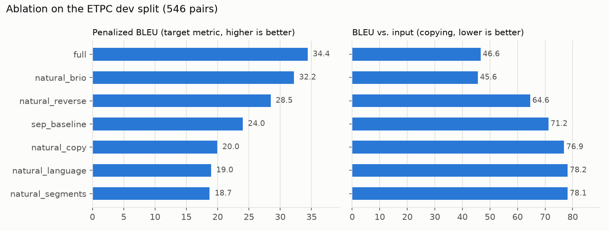
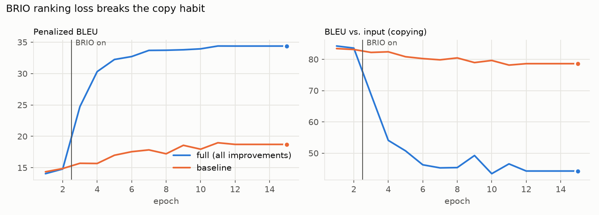

# Parafy: type-controlled paraphrasing with BART

[](../../actions/workflows/ci.yml)

**Author:** Mohammed Saif

**Controllable paraphrasing:** given a sentence and a list of linguistic *paraphrase types* (e.g. *synthetic/analytic substitution*, *diathesis alternation*, *addition/deletion*), generate a paraphrase that applies those changes.

I fine-tuned `facebook/bart-large` on the ETPC corpus and found that the main obstacle is not generating fluent text but **stopping the model from copying its input**. I attacked that failure mode from five directions: reverse augmentation, natural-language type prompts, a copy penalty, a **BRIO ranking loss**, and type-aware candidate reranking. Together they raise the target metric (Penalized BLEU) on the dev split **from 18.98 to 34.39 (+81%)**. A controlled add-one ablation, an analysis of the training logs and an inspection of the test outputs show where the gains come from, what they cost, and where the metric stops measuring what we want.



## The problem: copying is the easy way out

A model that copies its input word for word scores ~48 BLEU against the human reference while doing no paraphrasing at all. Plain fine-tuning learns exactly that habit: the baseline's outputs score **78 BLEU against their own input**. The task is therefore evaluated with **Penalized BLEU**, which rewards closeness to the reference *and* distance from the input:

```
penalized_bleu = BLEU(output, reference) × (100 − BLEU(output, input)) / 52
```

Every technique below targets that single failure mode.

## Method

| Component | What it does |
|---|---|
| **Leak removal** | Drops the 56 train rows whose id or sentence pair (normalised, either direction) also appears in dev |
| **Reverse augmentation** | Adds every pair with source and target swapped (2,128 → 4,210 pairs). The same sentence is now both a source and a target, so copying stops paying off. *Entailment* pairs are skipped because they only hold in one direction |
| **Natural-language type prompts** | Type ids like `11` become words BART has seen (`Synthetic/analytic substitution`), using the prompt template of Wahle et al. (2023) |
| **Label smoothing (0.1)** | There is more than one valid paraphrase, so the model should not be forced to be 100% certain about one |
| **Copy penalty** | An auxiliary loss pushing down the probability of source *content* words that the reference dropped. Tokens are canonicalised (`The`/`the`/`Ġthe` map to one id), and stopwords and repeated ids are ignored; without that the penalty fired on every word |
| **BRIO ranking loss** (Liu et al., 2022) | Each epoch the model decodes 4 candidates per training example. A margin loss teaches it to score candidates with higher (reference BLEU × distance from input) above worse ones. It switches on at epoch 3 |
| **Degenerate-output filter** | Rejects empty outputs, mid-sentence fragments and `in in in` repetition, in both the BRIO reward and the reranker |
| **Type-aware reranking** | Picks the best of 4 beams by model score (45%), distance from source (20%), agreement with the requested type (20%) and fluency (15%) |

All of it lives in [`bart_generation.py`](bart_generation.py).

## Results (dev split, 546 pairs)

Forward, add-one ablation: each row is the `natural_language` baseline with **one** change added. `full` has all of them.

| Run | Penalized BLEU | Δ vs baseline | BLEU vs reference | BLEU vs input ↓ | Rerank gain |
|---|---:|---:|---:|---:|---:|
| `full` | **34.39** | **+15.42** | 33.47 | 46.57 | +0.04 |
| `natural_brio` | 32.20 | +13.22 | 30.75 | 45.55 | +0.10 |
| `natural_reverse` | 28.46 | +9.49 | 41.76 | 64.55 | +1.02 |
| `sep_baseline` (numeric-id prompt) | 24.04 | +5.06 | 43.37 | 71.18 | +1.70 |
| `natural_copy` | 19.95 | +0.98 | 44.92 | 76.90 | +3.34 |
| `natural_language` (baseline) | 18.98 | — | 45.16 | 78.15 | +3.60 |
| `natural_segments` | 18.73 | −0.25 | 44.50 | 78.12 | +4.24 |



**What the ablation says**

- **BRIO is the single biggest win (+13.2).** It is the only component that optimises the shape of the metric directly. Once it switches on, copying drops from ~84 to ~45 BLEU vs input within a few epochs, and the score more than doubles.
- **Reverse augmentation is the best value (+9.5).** It is a pure data trick with no extra training cost.
- **The copy penalty barely helps on its own (+1.0).** It punishes single tokens, but copying is a sentence-level habit that cross-entropy keeps rewarding.
- **Reranking is a patch, not a fix.** It gives +4.2 to the weakest model and +0.04 to `full`, because once training has removed copies from the beams there is nothing left to rescue.
- **The gains overlap rather than stack.** The individual gains add up to +23.4, but `full` reaches +15.4, because every component attacks the same failure mode.

## Findings from the training logs and outputs

Everything in this section is computed from the saved [`metrics.json`](bart_generation_runs/) files and the [test predictions](predictions/etpc-paraphrase-generation-test-output.csv). No extra training was involved.

**1. Every run was stopped by the learning-rate schedule, not by convergence.** The linear schedule decays to zero at epoch 12. 6 of 7 runs reach their best score at epoch 11 or 12, still improving when the learning rate runs out, and every later epoch reproduces epoch 12's score exactly: 21 epochs across the grid trained with a learning rate of zero and did nothing. The reported numbers are therefore a lower bound on what each configuration can reach, and `full` in particular was still climbing (33.9 → 34.4 over its last updating epochs).

**2. Reverse augmentation makes BRIO converge faster.** With reverse data, `full` reaches 30.3 at epoch 4, one epoch after BRIO switches on. Without it, `natural_brio` needs until epoch 6 to reach 29.4. Swapped pairs give BRIO candidate pools that already contain non-copies to rank upward.

**3. Moving away from the input has a price, and it differs a lot per method.** Every run trades reference BLEU for distance from the input. Measured against the baseline, the reference BLEU lost per point of input BLEU removed is:

| Method | Reference BLEU lost per point of copying removed |
|---|---:|
| `natural_reverse` | 0.25 |
| `full` | 0.37 |
| `natural_brio` | 0.44 |

BRIO removes the most copying but pays the most for it. Reverse augmentation buys distance most cheaply, which makes it the best component when well-formed output matters more than the score.

**4. Reranking's value is a direct readout of how much the model copies.** Ordered by copy BLEU, the rerank gain falls almost monotonically: +3.3 to +4.2 at ~77–78 copy BLEU, +1.7 at 71, +1.0 at 65, ≤ +0.1 at ~46. A reranker can only choose among beams; once the beams stop being copies, it has nothing left to choose.

**5. Single-seed differences under ~1 point are noise.** Before the learning rate reaches zero, a run's dev score drops between consecutive epochs by up to 1.2 points (2.2 for `sep_baseline`) with no change in configuration. The +0.98 of the copy penalty and the −0.25 of segment locations fall inside that band, so the evidence that either one has any effect is weak.

**6. The prompt-format comparison is confounded.** `sep_baseline` beats `natural_language` by 5.1, but it also differs in label smoothing (0.0 vs 0.1). The evidence points at label smoothing, not prompt wording.

**7. The model learned the dataset's habit of adding facts, and the metric rewards it.** On the 585 test outputs, generated sentences are a median **1.17× the length of the source**, and 258 (44%) are more than 20% longer. 6.7% introduce a number that is not in the source and 2.4% a weekday (e.g. *"…fell 25 cents, **or 1.2 percent**, to close at $32.30 … **on Monday**"*). No output is an exact copy of its input. This is learned from the data: ETPC is built on MRPC, whose "paraphrases" are sentences from different news articles about the same event, and the dev references themselves introduce a new number 11.9% of the time and a new weekday 6.0% of the time. Adding plausible facts moves the output away from the input and towards the reference, so Penalized BLEU rewards it. Fixing it would require a meaning-preservation signal that the metric does not provide.

### Caveat: the metric can be gamed

Penalized BLEU can reward broken text. A sentence with its first half cut off is far from the input and still shares n-grams with the reference. The two BRIO runs have the highest scores but also the lowest reference BLEU, and in my dev-set inspection **over half of `full`'s outputs started lowercase**, a sign of fragments. That is why the degenerate-output filter exists. The filter is already part of the BRIO reward (degenerate candidates get quality 0 in `candidate_quality`). Its blind spot is the case where all four candidates are fragments: every pair is then tied at 0 and skipped, so BRIO gets no signal pointing towards a well-formed sentence. If you want the best result that stays reliably well-formed, use **`natural_reverse` at 28.46 (+9.5)**.

The test predictions ([`predictions/`](predictions/etpc-paraphrase-generation-test-output.csv), 585 rows) contain no exact copies of the input, and 1 of them (0.2%) starts lowercase.

## Limitations

- **One seed per configuration.** Differences below ~1 point are not distinguishable from training noise (finding 5).
- **The schedule capped every run** (finding 1), so the ablation compares configurations at a budget, not at convergence.
- **The metric measures surface overlap only.** It cannot see meaning changes, added facts or whether the requested paraphrase type was actually applied (finding 7).
- **Dev predictions are not saved**, only their corpus scores, so per-type and per-sentence error analysis on dev is not possible from the stored artifacts.

## Next steps

Ranked from cheapest to most involved. The first group needs no code changes, only runs with flags that already exist in `bart_generation.py`.

**Runs with existing flags**

1. **Longer schedule:** `--schedule_epochs 20`. Finding 1 suggests every configuration, especially `full`, still has headroom.
2. **Three seeds per configuration** (`--seed`), reporting mean ± std. This decides whether the copy penalty and segment locations do anything at all.
3. **Remove the label-smoothing confound:** `natural_language --label_smoothing 0`, to separate prompt format from label smoothing.
4. **Leave-one-out ablation** (`full` minus one component) to complement the add-one table and measure the overlap between components directly.
5. **Bigger candidate pool:** `--num_beams 8 --num_candidates 8` for both BRIO and reranking.

**Changes that need code**

6. **Anchor BRIO with the gold reference:** add the reference as a candidate, so the ranking always has a well-formed positive even when every decoded candidate is a fragment (the blind spot in the caveat above).
7. **More diverse BRIO candidates:** diverse beam search or sampling instead of 4 near-identical beams, so that fewer candidate pairs are tied and skipped.
8. **Minimum Bayes-risk decoding:** pick the candidate with the highest expected Penalized BLEU against the other candidates, replacing the hand-tuned reranker weights with the metric itself.
9. **A meaning-preservation term:** BERTScore or an NLI entailment check, in both the BRIO reward and the evaluation, to stop the model from rewarding added facts (finding 7).
10. **Measure whether the requested types were applied:** a paraphrase-type classifier on the outputs, so the "controllable" part of the task is evaluated and not only assumed.
11. **Save dev predictions** next to `metrics.json` to enable per-type error analysis.

## Quickstart

```bash
pip install -r requirements.txt          # Python 3.10+; install the CUDA build of torch for training
pytest -q                                # fast CPU checks, no model download
python bart_generation.py --run_name full                 # train + evaluate + write test predictions (GPU)
python bart_generation.py --run_name natural_reverse --no_segments --copy_weight 0 --brio_weight 0 --no_submission
python collect_metrics.py                # rebuild the ablation table from bart_generation_runs/*/metrics.json
python plot_results.py                   # rebuild the figures in assets/
python predict.py --checkpoint bart_generation_runs/full  # test predictions from a trained checkpoint
```

The trained checkpoints (~1.6 GB each) are not in the repo. Only their `metrics.json` files are kept, so `predict.py` needs a retrained checkpoint.

<details><summary>Flags for each ablation run</summary>

| Run | Flags |
|---|---|
| `natural_language` | `--no_reverse --no_segments --copy_weight 0 --brio_weight 0` |
| `natural_segments` | `--no_reverse --copy_weight 0 --brio_weight 0` |
| `natural_copy` | `--no_reverse --no_segments --brio_weight 0` |
| `natural_reverse` | `--no_segments --copy_weight 0 --brio_weight 0` |
| `natural_brio` | `--no_reverse --no_segments --copy_weight 0` |
| `sep_baseline` | `--prompt sep --no_reverse --copy_weight 0 --brio_weight 0 --label_smoothing 0` |
| `full` | *(defaults)* |

Add `--no_submission` to every ablation run so it doesn't overwrite the test predictions.
</details>

## Hyperparameters

`facebook/bart-large` · AdamW lr 3e-5 (eps 1e-6, no weight decay) · batch 16 · linear warmup (10%), then decay over 12 epochs · max 20 epochs, patience 4 · label smoothing 0.1 · copy weight 0.5 · BRIO weight 0.2 from epoch 3 · 5 beams / 4 candidates · no-repeat 3-gram · 60 new tokens · seed 11711.

## Repository layout

```
bart_generation.py      training, losses, BRIO, reranking, evaluation
predict.py              test predictions from a trained checkpoint
collect_metrics.py      ablation table from bart_generation_runs/*/metrics.json
plot_results.py         README figures
create_dev_split.py     80/20 split of the ETPC train set (seed 11711)
data/                   ETPC splits + type-id → name map
bart_generation_runs/   metrics.json per ablation run (+ ablation_metrics.csv)
predictions/            test-set output
tests/                  CPU smoke tests
```

## References

**Data:** ETPC, Kovatchev, Martí & Salamó (2018), *ETPC: A paraphrase identification corpus annotated with extended paraphrase typology and negation*, LREC. Built on MRPC, Dolan & Brockett (2005).

- Lewis et al. (2020). BART: Denoising sequence-to-sequence pre-training. *ACL*.
- Liu, Liu, Radev & Neubig (2022). BRIO: Bringing order to abstractive summarization. *ACL*.
- Wahle, Gipp & Ruas (2023). Paraphrase types for generation and detection. *EMNLP*.
- Welleck et al. (2020). Neural text generation with unlikelihood training. *ICLR*.
- Szegedy et al. (2016). Rethinking the Inception architecture (label smoothing). *CVPR*.
- Post (2018). A call for clarity in reporting BLEU scores. *WMT*.

## License

Apache-2.0, see [LICENSE](LICENSE).
